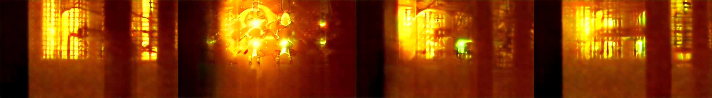

# NopeeClaude

*Nopee* is Finnish for *fast*. This is an attempt to understand how "faster Wan" works, rebuilt
small enough to run on one RTX 3060 (12 GB VRAM, 24 GB RAM).

*Do not hype. Do not lie. Just show.* The experiment is preregistered in
[`docs/PREREG.md`](docs/PREREG.md), and the gates and my predictions are written there before any
real run. **No real Wan run has been done yet.** The code was built and tested in a sandbox with
no GPU and no access to Hugging Face, against a randomly initialised miniature Wan that runs the
same diffusers code paths. The first real numbers will come from your 3060.

## Status, Nov 1 2026 evening: what the 3060 showed, and what I think

**Short version: not the bee's knees. Don't run the 4-hour main experiment in its current
form.** The measurements before any adapter was trained already answer most of the question, and
the answer isn't the one the design assumed.

**Measured on the 12 validation prompts** (`inspect_data.py`; "share" = latent distance to the
40-step reference as a fraction of the distance between two unrelated videos; "low" = the same
after keeping only rough layout):

| budget | time | speedup | share | layout share | correlation | PSNR to ref (4 prompts) |
|---|---|---|---|---|---|---|
| s6 | 13.9 s | 6.6× | 0.42 | 0.36 | 0.67 | 8–14.5 dB |
| s12 | 27.7 s | 3.3× | 0.32 | 0.26 | 0.75 | 10–17.4 dB |
| s24 | 55.4 s | 1.7× | 0.21 | 0.14 | 0.83 | 12–18.6 dB |
| 40 steps + cache 0.3 | 28.3 s | 3.2× | ≈0.12* | | | |
| 40 steps + cache 0.5 | 21.5 s | 4.3× | ≈0.23* | | | |

\* From the 3-prompt cache sweep (MSE 0.48 and 0.95), divided by the unrelated-video MSE of 4.19.
Different prompts, so this is indicative only.

Each strip below is reference | 6 steps | 12 steps | 24 steps, middle frame (validation prompts):




**What I read from this:**

1. **Cutting steps doesn't make a rougher copy; it makes a broken or different video.** At 6
   and 12 steps the subject is often gone: no robot, the waterfall smeared into vertical streaks.
   Sometimes something new appears: at 6 steps the cathedral window turned into a chandelier. Only
   at 24 steps (just 1.7× faster) does the scene come back. A ~5k-parameter local filter can't
   repair that. Trained to minimise the distance, it would learn to blur toward an average and
   could "pass" G1 while making the video worse. The final-latent adapter experiment is therefore
   dead before training. By the rule I wrote in advance, Amendment 2 does *not* trigger (share
   0.42 < 0.5). The previews show a problem that rule didn't foresee, so I'm pausing rather than
   switching (see `docs/PREREG.md`).
2. **The reference itself isn't good at this size.** Wan2.2-TI2V-5B was trained at 704×1280. At
   320×576 even the 40-step reference is oversaturated and streaky. Everything measured here is a
   model running far from its design point, so it isn't a fair picture of Wan, of TBC, or of the
   idea.
3. **The lever that works is caching, and it needs no neurons.** At the same 28 s, keeping 40
   steps with FirstBlockCache 0.3 stays far closer to the reference than cutting to 12 steps.
   Cache 0.5 is 4.3× faster and still closer than 12 steps. That matches TBC's own account of
   where their prototype's speed came from (cache, a better sampler, fewer steps, serving). It also
   means most of a "5× faster Wan" is available with a one-line diffusers setting.
4. **The other way to get real few-step Wan is distillation**: a model *trained* to sample in 3–4
   steps (FastVideo's FastWan2.2-TI2V-5B, LightX2V). That's a full training job, not a 0.1%
   adapter, and it's how the public fast versions do it.

**What is still worth doing, if anything:**
- **The plausible TBC shape:** an adapter that cleans up *caching* errors (40 steps + cache 0.3–0.5).
  Those errors are smaller and more local, the kind a small filter could fix. It's only fair at a
  resolution where the reference is good: try 480×832 first, and check the reference preview
  before generating anything. On a 3060 that's roughly 2.5–3× the time per video.
- **Or stop here** with the honest conclusion: on consumer hardware, fast Wan means caching plus
  distilled checkpoints. Whether neuron-derived constants add anything can't be tested without
  TBC's recordings, and this repo can't supply those.

## What TBC says they did

Sources: their [technology page](https://www.tbc.co/technology),
[press release](https://www.tbc.co/press-releases/neuron-derived-ai-video-model) and two blog posts:
[the neural dynamics adapter](https://www.tbc.co/post/the-neural-dynamics-adapter) and
[a sense of space and time](https://www.tbc.co/post/a-sense-of-space-and-time-optimizing-interactive-video-generation).

**The product (mischief 1).**
- Wan 2.2 plus a modification adding less than 0.1% parameters.
- Claimed 5× faster "at matching quality".
- No metrics, no variant and no step counts are published.

**The prototype (Oasis, a Minecraft world model).**
- A *hypercolumn adapter*: small residual branches added at the transformer blocks.
- Per location, a difference-of-Gaussians spatial kernel (space constant λ) and a leaky E/I
  recurrence (time constant τ).
- λ and τ were fitted to how evoked activity spreads and decays in neuron cultures on a
  4,096-electrode array.

**Their own account of where the speed came from.**
- A streaming cache;
- the DPM++ sampler;
- fewer steps;
- serving.

The adapter's job was to keep quality while those made generation cheaper. In the prototype it
mostly stopped long rollouts from drifting.

**Not published:**
- equations;
- the constants;
- the loss;
- any ablation that swaps the biological constants for non-biological ones.

## So, do we understand it the same way?

At the level they have published, I think yes. Fast video generation is ordinary
engineering: fewer sampling steps, a better solver, and caching work that repeats between steps.
What a cheap run loses is mostly systematic: few-step flow sampling misses fine detail, and caching
adds small temporal errors. A small filter can learn to give some of that back.
- A centre-surround (DoG) kernel is a band-pass, which is almost a sharpening filter.
- A leaky E/I recurrence over frames is a damped temporal filter.

The open question is whether the *neuron-derived* constants matter at all, or whether any small
filter in that slot would do. Their posts don't answer it, so this repo tests it with controls:
learned, hand-chosen, random constants, and unconstrained kernels.

## What this repo does

1. **Paired data.** Wan2.2-TI2V-5B at 320×576 and 33 frames. For each prompt it runs the expensive
   reference (40 steps) and cheap budgets (6, 12, 24 steps, and 12 steps with FirstBlockCache),
   all from **the same initial noise**. The cheap runs are then coarser solutions of the same ODE,
   so "what did the cheap run lose" is well defined.
2. **Final-latent adapters.** About 5k parameters each, trained in minutes on the cached latents:
   cheap latent → reference latent. Arms: hypercolumn (learned, fixed prior or random constants),
   free kernels, tuned unsharp mask, none.
3. **Stage 2: TBC's actual shape.** Branches on the first four transformer blocks: about 0.8M
   parameters, about 0.02% of the 5B transformer, inside TBC's "less than 0.1%". They are trained
   by distillation through the frozen transformer. This part is exploratory.
4. **Gates.** Does it recover error (G1)? Does it buy a budget (G2)? Is it the structure (G3), the
   constants (G4), or just sharpening (G5)?

## Running it on the 3060

```bash
pip install -r requirements.txt
huggingface-cli login            # if needed; the model is Wan-AI/Wan2.2-TI2V-5B-Diffusers

# phase 1 alone first: the text encoder (int8 via bitsandbytes on the GPU, ~6 GB VRAM)
python make_data.py --only-text

# 0. time it first on a few prompts (prints seconds per budget per prompt)
python make_data.py --n-train 2 --n-val 1 --n-test 2 --out data_trial

# 1. the preregistered data (resumable: stop and restart freely; budgets can be added later)
python make_data.py --splits val --budgets ref,s6,s12,s24     # validation prompts first (~40 min)
python cache_sweep.py                                          # pick the cache threshold (PREREG Amendment 1)
python make_data.py --budgets ref,s6,s12,s24                   # everything else (~4 h on a 3060)
python make_data.py --budgets s12c<chosen>                     # add the cache budget to every prompt
python preview.py --data data --budgets ref,s6,s12             # look at some videos (VAE only)

# 2. final-latent adapters (minutes)
python train_adapters.py

# 3. gates + decoded PSNR/flicker + side-by-side videos (reference | 6 steps | 6 steps + adapter)
python evaluate.py --decode

# 4. stage 2 (optional, slower): in-block adapter, then regenerate the test set with it
python train_inblock.py
python evaluate.py --decode --inblock
```

Results land in `results/`: `metrics.json`, `summary.md` and the side-by-side `.mp4` files.

**Memory plan.**
- Phase 1 loads only the UMT5-XXL text encoder (stored in fp8 on the GPU). It encodes all the
  prompts once and is freed.
- Phase 2 loads the transformer stored in fp8 (about 5 GB) and computes in bf16, which works on
  Ampere, plus the VAE in fp32 with tiling.

**If it dies silently** (no traceback), it was killed from outside, usually for memory. Every
stage prints a `[...] RAM used / free, VRAM free` line, so the last one shows where it died. On
Windows, `echo %errorlevel%` right after gives the exit code.

**If it doesn't fit:**
- `--offload` (model CPU offload);
- `--te cpu` (text encoder on the CPU) or `--te fp8`;
- `--model wan21-1.3b` (Wan2.1, 1.3B; much faster, a fine dry run);
- `--height 256 --width 448`.

**Tests and smoke run (CPU, no download).**

```bash
python -m pytest -q
python make_data.py --tiny --out runs/smoke/data --n-train 8 --n-val 3 --n-test 6
python train_adapters.py --data runs/smoke/data --out runs/smoke/adapters --steps 200
python evaluate.py --data runs/smoke/data --adapters runs/smoke/adapters --out runs/smoke/results --decode
```

## What it will and won't show

- **No neurons.** The "fixed" constants are hand-chosen, not measured. A G4 pass would mean "these
  hand-chosen constants beat random ones", not "biology helps".
- **A proxy, not FVD.** Closeness to a same-noise 40-step reference stands in for "matching
  quality". It is not FVD and not a human rating.
- **The bar for "faster Wan" is high.** Open few-step distillations of Wan already exist
  (LightX2V; FastVideo's FastWan2.2-TI2V-5B). TBC's "5×" is not beyond what those claim. This
  repo asks a narrower question: does a tiny structured adapter make cheap sampling cheaper at
  equal closeness, and is the structure the reason?

## Files

| file | what it does |
|---|---|
| `nopee/adapters.py` | DoG, leaky E/I, free kernels, unsharp, final-latent adapter, in-block hooks |
| `nopee/wan.py` | two-phase loading for 12 GB, shared-noise generation, timing, trajectories, decode, guided model call |
| `nopee/data.py` | loading, per-prompt errors, paired bootstrap |
| `make_data.py` | paired data |
| `train_adapters.py` | trains the final-latent adapters |
| `train_inblock.py` | stage 2 |
| `evaluate.py` | gates, decoded metrics, videos |
| `prompts.txt` | 98 prompts |
| `docs/PREREG.md` | the preregistration |
| `tests/` | 7 tests: identity at init, causality, centre-surround, our model call equals the pipeline's, gradients through the frozen transformer |
